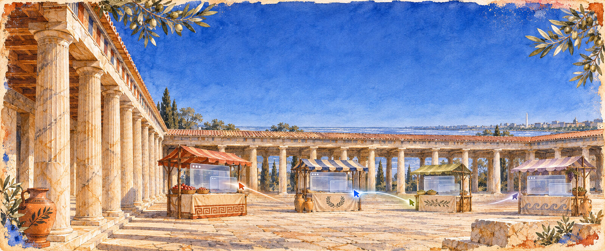

# Agora



[](https://github.com/olimpiacloud/agora/actions/workflows/ci.yml)
[](https://github.com/olimpiacloud/agora/releases/latest)
[](#license)

Agora gives AI agents a real Linux computer, with Chromium, X11 apps and a terminal, without starting a desktop and a browser for each agent. It is a single Go daemon: each workspace has one Xvfb display and one Chromium, and agents work in it as **cursors**. A cursor has its own identity, permissions, input seat, tabs, parent and children, and structured results. Humans watch over a damage-driven H.264 stream and can take control when an agent hits a CAPTCHA or a login. Agents use it through MCP, an HTTP API or the Paseo plugin.

**Agora by [Olimpia](https://olimpia.dev).**

## Features

- **Cursors, not containers.** Five agents share one desktop and one browser, each with its own windows, its own MPX pointer and keyboard, and its own token. Permissions can only narrow when an agent spawns a subagent. Pause, cancel (cascading), wait, messaging and a shared board with claims (so parallel subagents do not repeat each other's work) are built in.
- **Truly concurrent input.** Two agents type into two windows at the same time without mixing keys. In Chromium, input goes per tab over CDP, with no OS focus at all.
- **Semantic and visual control.** A compact snapshot with refs (`[e3] button "Sign in"`) for pages, and after each action only what changed. Clicks by ref or coordinates, fill, select, upload, downloads, dialogs, drag, eval, device emulation, and a built-in UI audit. Pixel control for any X11 app.
- **Human in the loop.** CAPTCHAs and logins are detected, the cursor moves to `needs_human`, a person takes over from the viewer, then hands control back. The agent continues on the same tab and session.
- **Persistent workspaces.** Freeze, suspend and resume with tabs restored to their owners. Copy-on-write profile forks, checkpoints, TTLs, and memory, CPU, cursor and tab budgets. An unused workspace costs nothing.
- **Streaming that costs nothing when nobody watches.** H.264 over WebRTC, or WebSocket + WebCodecs through HTTP tunnels, encoded once and fanned out to every viewer. Damage-driven JPEG for light clients. The frame rate follows what the human is doing.
- **Built for agents.** An MCP server with 50 tools (`agora mcp`), a launcher for Claude Code, Codex or any command with a lean profile and per-cursor token usage, and git worktrees with a port range per subagent.
- **Dashboard and Paseo.** An embedded React dashboard and viewer, and a [Paseo](https://paseo.sh) plugin with the live desktop in a panel (it works on mobile) and screenshot cards in the chat.

## Benchmarks

Against Xvfb + x11vnc + noVNC + Chrome on the same machine (Ryzen 5 3400G, 8 threads; Chromium included on both sides). `go run ./cmd/agora-bench` reproduces it. Full results: [bench/results/runtime-after/latest.md](bench/results/runtime-after/latest.md).

| scenario | Agora | noVNC stack |
|---|---:|---:|
| Five agents with a browser, memory (PSS) | **326 MB** | 1,454 MB |
| New agent ready | **156 ms** | 521 ms |
| Empty desktop, memory / start time | **36 MB / 98 ms** | 82 MB / 246 ms |
| Click to DOM `mousedown`, p50 | **1.1 ms** | 3.9 ms |
| Semantic snapshot for an agent, p50 | **1.2 ms** | n/a |
| Streaming bandwidth, 1 viewer | **303 kbit/s** | 5,862 kbit/s |
| Streaming, 3 viewers, server CPU | 22.5 % | 19.2 % |
| Suspended workspace, memory | **41 MB** | 331 MB, and the session is lost |
| Memory per idle cursor | **1.3 KB** | a full stack each |

On subagent cost, the lean launcher brought the initial context per subagent from 66.7k to 7.5k tokens and the cost of a six-task suite from $2.01 to $0.23 with the same results ([bench/results/OPTIMIZATION.md](bench/results/OPTIMIZATION.md)).

Streaming uses more CPU than a raw VNC framebuffer because it encodes H.264, in exchange for about 20 times less bandwidth.

## Install

Ubuntu or Debian, amd64 or arm64:

```sh
curl -fsSL https://agora.olimpia.dev/install.sh | sudo sh
```

The installer is idempotent. It installs Xvfb, VA-API and Google Chrome (Chromium on arm64), creates the unprivileged `agora` user, downloads the release binary and checks its SHA-256 (or builds from source when there is no release), installs `/usr/local/bin/agora` and the `agora.service` systemd unit, and starts it. If Claude Code, Codex or Paseo are installed it registers the Agora MCP server, the Agora skill and the Paseo plugin. Options go after `sh -s --`: `--version vX.Y.Z`, `--prefix DIR`, `--source DIR`, `--no-agents`, `--no-paseo`.

Uninstall with `curl -fsSL https://agora.olimpia.dev/uninstall.sh | sudo sh`. It stops and removes the service, the binary and the agent configuration. `--purge` also deletes `/var/lib/agora` (every workspace and browser profile) and the `agora` user.

From source: `make build` (needs Go, `pkg-config`, `libx264-dev` and `libva-dev`), then copy `bin/agora` and `deploy/agora.service`.

## Quickstart

The daemon listens on `127.0.0.1:7788`. Open the dashboard there and paste the token from `sudo agora token`.

Give your agent a computer:

```sh
claude mcp add agora -s user -- agora mcp
codex mcp add agora -- agora mcp
```

Any other MCP client:

```json
{ "mcpServers": { "agora": { "command": "agora", "args": ["mcp"], "env": { "AGORA_TOKEN": "<cursor or admin token>" } } } }
```

Or drive it over HTTP:

```sh
WS=$(agora api POST /v1/workspaces '{"name":"demo","start":true}' | jq -r .id)
agora api POST /v1/cursors "{\"name\":\"main\",\"workspace\":\"$WS\"}"
agora api POST /v1/workspaces/$WS/tabs '{"url":"https://example.com"}'
agora api POST /v1/workspaces/$WS/tabs/<target> '{"action":"snapshot"}'
agora open $WS
```

`agora open` prints a viewer link with a short-lived token. Spawn a real subagent that Agora launches and tracks:

```sh
agora api POST /v1/cursors '{"name":"reader","parent":"<cursor>","goal":"Open example.com and return its title","launch":{"adapter":"claude","model":"claude-haiku-5-5"}}'
agora api POST /v1/wait '{"ids":["<child>"]}'
```

With Paseo: `paseo plugin install ./paseo-plugin`. Every Claude or Codex agent in Paseo then gets its own Agora cursor, and the workspace gets a live desktop panel. Add the label `agora/enabled=false` to an agent to opt it out.

## Architecture

One Xvfb and one Chromium per workspace, MPX seats per cursor, CDP over a pipe, XDamage-driven capture and x264. Why, and what we ruled out (Wayland, Xpra, VNC, one browser per agent): [docs/ARCHITECTURE.md](docs/ARCHITECTURE.md).

## Security

- The daemon only listens on loopback and refuses other interfaces. To reach it remotely, put it behind an authenticated tunnel such as Cloudflare Tunnel with Access, never an open port.
- Browsers and apps run as the unprivileged `agora` user with Chrome's sandbox enabled and no access to root's files. CDP has no TCP port.
- Every call needs a token. Cursor tokens are scoped to a workspace and a permission set, and viewer links expire.
- Cursors in the same workspace are isolated logically, not by a security boundary. Use separate workspaces for agents that must not see each other.
- `config.sandbox: true` runs a workspace's Chrome and apps with a read-only system, a private home and no view of other workspaces. See [docs/SANDBOX.md](docs/SANDBOX.md) for what it does and does not protect against.

Report vulnerabilities privately: [SECURITY.md](SECURITY.md).

## Contributing

Build, test and PR conventions are in [CONTRIBUTING.md](CONTRIBUTING.md). Changes are listed in [CHANGELOG.md](CHANGELOG.md). Please follow the [code of conduct](CODE_OF_CONDUCT.md).

## License

Dual-licensed under [MIT](LICENSE-MIT) or [Apache-2.0](LICENSE-APACHE), at your option.
